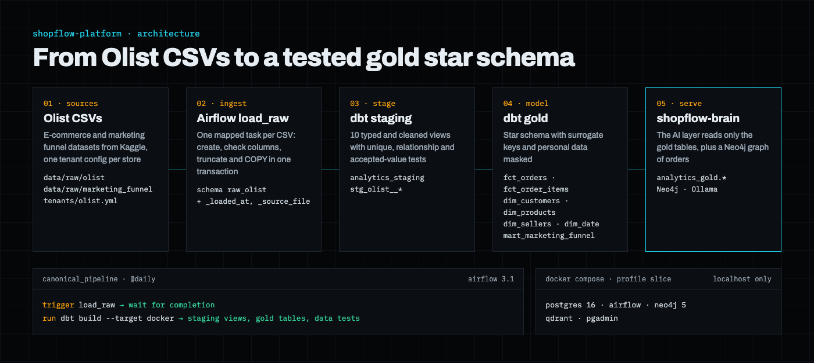

# ShopFlow Platform

A data platform for a fictional online store, built on the public Olist e-commerce and
marketing funnel datasets from Kaggle (almost 100,000 orders from a Brazilian marketplace).
Airflow loads the raw CSV files into PostgreSQL, and dbt turns them into tested staging
views and a gold star schema. The AI layer,
[shopflow-brain](https://github.com/adegbenleb/shopflow-brain), reads only the gold tables.
A personal learning project.



Part of my portfolio: **https://adegbenleb.github.io/portfolio/**

## How it works

1. **Sources.** The Olist CSV files go in `data/raw/olist/` and `data/raw/marketing_funnel/`.
   Each store is described by a tenant file in `tenants/` (for example `tenants/olist.yml`):
   its name, its target schema and its source folders.
2. **Raw load** (`ingestion/dags/load_raw.py`). The `load_raw` DAG reads the tenant files and
   starts one mapped task per CSV, at most four at a time. Each task creates the table if
   needed (all columns as text, plus `_loaded_at` and `_source_file`), checks that the
   column layout has not changed, then truncates and copies the file in one transaction.
3. **Staging** (`transform/models/staging/olist/`). dbt builds 10 views in
   `analytics_staging`: typed timestamps and amounts, cleaned names, deduplicated reviews,
   English category names. Tests check uniqueness, not-null columns, relationships between
   tables and accepted values.
4. **Gold** (`transform/models/gold/`). dbt builds a star schema in `analytics_gold` with
   surrogate keys and personal data masked (postal codes cut to the area):

   | Model | Grain |
   |---|---|
   | `fct_orders` | One row per order: totals, payments, review score, delivery days, late flag |
   | `fct_order_items` | One row per order line: price and freight |
   | `dim_customers` | One row per real customer: postal area, city, state, no raw IDs |
   | `dim_products` | Category in English, dimensions, photo count |
   | `dim_sellers` | Postal area, city, state |
   | `dim_date` | Calendar from 2016 to 2019 |
   | `mart_marketing_funnel` | One row per marketing lead: won or not, days to close, seller revenue |

5. **Orchestration** (`ingestion/dags/canonical_pipeline.py`). The `canonical_pipeline` DAG
   runs daily: it triggers `load_raw`, waits for it, then runs `dbt build`, so a failed data
   test stops the pipeline.

Design decisions and trade-offs are written down in [`docs/decisions.md`](docs/decisions.md)
and [`docs/decisions-phase1.md`](docs/decisions-phase1.md).

## Services

Started with Docker Compose (`docker/compose.yml`, profile `slice`). All ports are bound to
localhost only.

| Service | URL |
|---|---|
| Airflow 3.1 | http://localhost:18080 |
| PostgreSQL 16 | localhost:15432 |
| pgAdmin | http://localhost:18082 |
| Neo4j 5 | http://localhost:17474 (bolt: localhost:17687) |
| Qdrant | http://localhost:16333/dashboard |

## Run it locally

Needs Docker, Python 3.12 with [uv](https://docs.astral.sh/uv/), and the Olist datasets
from Kaggle. The data is not part of this repo.

```bash
# 1. Install and configure
uv sync
cp .env.example docker/.env        # then set your own passwords

# 2. Put the CSV files in place
#    data/raw/olist/              the eight olist_*_dataset.csv files and
#                                 product_category_name_translation.csv
#    data/raw/marketing_funnel/   olist_closed_deals_dataset.csv and
#                                 olist_marketing_qualified_leads_dataset.csv

# 3. Start the services (the first start builds the Airflow image)
docker compose -f docker/compose.yml --profile slice up -d

# 4. Run the pipeline: open Airflow at http://localhost:18080, unpause and trigger
#    canonical_pipeline, or from the terminal:
docker compose -f docker/compose.yml exec airflow airflow dags trigger canonical_pipeline

# Stop everything
docker compose -f docker/compose.yml --profile slice down
```

## Tests

```bash
uv run ruff check . && uv run ruff format --check .
uv run pytest -q
```

The Python tests cover the tenant configuration (validation, schema names, how files map to
tables, duplicate detection), the shared database credentials and the project setup. The
data tests run inside `dbt build`. GitHub Actions runs lint, tests and a Docker Compose
config check on every push to main and on pull requests.

## Status

Working today: tenant-based raw loading, staging, the gold star schema with tests, and the
daily pipeline. Not built yet: a silver layer (skipped until there is a second tenant), the
use of Qdrant, and change data capture (Postgres already runs with `wal_level=logical` for
it).

## Stack

Python 3.12, Apache Airflow 3.1, dbt (Postgres), PostgreSQL 16, Neo4j 5, Qdrant, Docker
Compose, pytest, ruff, uv, GitHub Actions.
